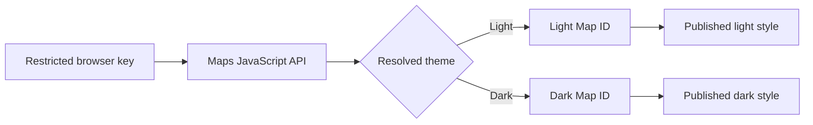

A themed Google map needs three different things: a **browser API key** to load the Maps JavaScript API, **Map IDs** to select maps in your code, and **published Cloud styles** attached to those IDs. This guide follows the two-ID setup used by this portfolio: one light Map ID and one dark Map ID. Nothing here requires putting style JSON into the browser.



## 1. Prepare the project and browser key

In [Google Cloud Console](https://console.cloud.google.com/), select or create your own project with billing enabled. Open the [API Library](https://console.cloud.google.com/apis/library) and enable **Maps JavaScript API**; Google's [JavaScript API setup guide](https://developers.google.com/maps/documentation/javascript/get-api-key) walks through the prerequisites. Then open [Credentials](https://console.cloud.google.com/apis/credentials) and create an API key for this website.

In that key's settings, choose **Application restrictions → Websites (HTTP referrers)**. Add the production site and its path wildcard, for example `https://www.example.com` and `https://www.example.com/*`; add the local development origin and path wildcard separately, including its port, for example `http://localhost:4321` and `http://localhost:4321/*`. Add preview domains only if you actually use them. Under **API restrictions**, select **Restrict key → Maps JavaScript API** (plus only other APIs the same website needs), save, and test each environment. See Google's [website-restriction instructions](https://cloud.google.com/docs/authentication/api-keys) and [Maps Platform key guidance](https://developers.google.com/maps/api-security-best-practices).

> **Tip:** Avoid restricting the key to a single page path. Browsers may send only the origin in a cross-origin referrer, which can make an otherwise valid page fail the website restriction.

The key is delivered to the browser, so **it is not a secret**. Restrictions, not hiding it in client code, limit where and for what it can be used. Never paste your real key into a public tutorial. A Map ID is different: it identifies the map configuration and its associated Cloud style; it does not authenticate API requests.

## 2. Create two JavaScript Map IDs

Open [Map Management](https://console.cloud.google.com/google/maps-apis/studio/maps) and create two Map IDs for the **JavaScript** platform, named something like `Site light` and `Site dark`. Use the map type your design needs; this example uses a vector `roadmap`. Copy both IDs for the code later. They are identifiers, **not** API keys. [Google's style setup guide](https://developers.google.com/maps/documentation/javascript/cloud-customization/map-styles) explains how Map IDs connect app code to styles.

## 3. Import and publish the Cloud styles

In [Map Styles](https://console.cloud.google.com/google/maps-apis/studio/styles), create a light style and a dark style. If you have Cloud-style JSON files, choose **Create style → JSON**, paste or upload each file, check the preview and validation, then customize and save. This portfolio's examples are [`light.cloud.json`](https://github.com/namroj/astro-portfolio/blob/main/src/assets/map-themes/light.cloud.json) and [`dark.cloud.json`](https://github.com/namroj/astro-portfolio/blob/main/src/assets/map-themes/dark.cloud.json). Their `variant`, `backgroundColor`, and `styles` structure belongs to Cloud styling; a legacy JavaScript `styles: [...]` array is **not interchangeable** with this import format. See the [JSON import section of Google's style guide](https://developers.google.com/maps/documentation/javascript/cloud-customization/map-styles#json-import) and its [dedicated JSON import guide](https://developers.google.com/maps/documentation/javascript/cloud-customization/json).

The first saved version of a newly created Cloud style is published automatically. For later edits, **Save** creates a draft; use **Publish** when the new version should reach live maps. Changes can take time to propagate. On each Map ID's detail page, associate the light style with the light ID and the dark style with the dark ID in the matching mode slot. Check the map preview before moving to code. [Google documents publication and association](https://developers.google.com/maps/documentation/javascript/cloud-customization/map-styles).

> **Tip:** Preview each Map ID in the Console before debugging JavaScript. If its colors are wrong there, fix the style association or published version first.

> **Alternative:** Google also lets you attach one light style and one dark style to a **single** Map ID. The two-ID path here mirrors the portfolio implementation; a new project can choose the [single-ID arrangement](https://developers.google.com/maps/documentation/javascript/cloud-customization/modes-and-types) instead.

## 4. Load and switch the map

Replace the placeholders below with your restricted browser key and two Map IDs. Put the map in a container with a nonzero height. The Maps script loads asynchronously, and `importLibrary("maps")` provides the `Map` class. This small example accepts an explicit `light`, `dark`, or `system` preference; wire `setMapTheme` to your own theme control.

```html
<div id="map" style="height: 400px"></div>
<script>
  const mapElement = document.getElementById("map");
  const systemTheme = matchMedia("(prefers-color-scheme: dark)");
  const mapIds = {
    light: "YOUR_LIGHT_MAP_ID",
    dark: "YOUR_DARK_MAP_ID",
  };
  let preference = "system";

  async function renderMap() {
    const { Map } = await google.maps.importLibrary("maps");
    const theme =
      preference === "system"
        ? systemTheme.matches
          ? "dark"
          : "light"
        : preference;

    mapElement.replaceChildren();
    new Map(mapElement, {
      center: { lat: -12.5, lng: -65 },
      zoom: 4,
      mapId: mapIds[theme],
      colorScheme: theme === "dark" ? "DARK" : "LIGHT",
    });
  }

  window.initMap = renderMap;
  window.setMapTheme = (next) => {
    preference = next; // "light", "dark", or "system"
    void renderMap();
  };
  systemTheme.addEventListener("change", () => {
    if (preference === "system") void renderMap();
  });
</script>
<script
  async
  src="https://maps.googleapis.com/maps/api/js?key=YOUR_BROWSER_API_KEY&loading=async&callback=initMap"
></script>
```

Google says [`colorScheme` must be set at initialization](https://developers.google.com/maps/documentation/javascript/mapcolorscheme); changing it on an existing map has no effect. Rebuilding the map also applies the newly selected Map ID. In a component, remove old markers, polylines, and listeners before rebuilding. This portfolio resolves its site theme to light or dark and listens for operating-system changes only while **system** is selected.

> **Tip:** `system` is a preference, not a third Cloud style. Resolve it to light or dark before choosing the Map ID.

## If the map or theme is missing

- **Blank map or authorization error:** check billing, Maps JavaScript API enablement, the key's API restriction, and the current page's HTTP referrer (including localhost or a preview domain).
- **Default or wrong colors:** verify the selected Map ID, the correct light/dark mode association, and that the intended style version is published. Give Cloud changes time to propagate.
- **Theme changes but map does not:** creating a new map is necessary; `colorScheme` is not mutable after initialization. Also confirm the map container still has a height.

The reusable boundary is simple: **key loads the API; Map ID selects the Cloud configuration; theme selects the matching ID and initial color scheme**. Keep those responsibilities separate and debugging becomes much easier.

See the [portfolio journey map](/en/from-venezuela-to-argentina/) for a live example of the two-ID setup.
