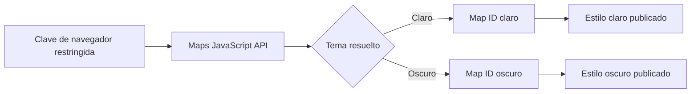

Un mapa con temas necesita tres elementos distintos: una **API key de navegador** para cargar Maps JavaScript API, **Map IDs** para seleccionar el mapa desde el código y **estilos Cloud publicados** asociados a esos IDs. Esta guía sigue la configuración de este portfolio: un Map ID claro y otro oscuro. No hace falta enviar el JSON de estilos al navegador.



## 1. Prepara el proyecto y la clave de navegador

En [Google Cloud Console](https://console.cloud.google.com/), selecciona o crea tu propio proyecto con la facturación habilitada. Abre la [Biblioteca de API](https://console.cloud.google.com/apis/library) y activa **Maps JavaScript API**; la [guía de configuración de JavaScript](https://developers.google.com/maps/documentation/javascript/get-api-key) explica los requisitos previos. Después, abre [Credenciales](https://console.cloud.google.com/apis/credentials) y crea una API key para el sitio.

En la configuración de esa clave, selecciona **Restricciones de aplicación → Sitios web (referentes HTTP)**. Agrega el sitio de producción y su comodín de ruta, por ejemplo `https://www.example.com` y `https://www.example.com/*`; agrega por separado el origen local y su comodín, incluido el puerto, por ejemplo `http://localhost:4321` y `http://localhost:4321/*`. Añade dominios de vista previa solo si los utilizas. En **Restricciones de API**, selecciona **Restringir clave → Maps JavaScript API** (más cualquier otra API que el mismo sitio necesite), guarda y prueba cada entorno. Consulta las [instrucciones para restringir sitios web](https://cloud.google.com/docs/authentication/api-keys) y las [recomendaciones de Maps Platform](https://developers.google.com/maps/api-security-best-practices).

> **Consejo:** Evita restringir la clave a la ruta de una sola página. En solicitudes entre orígenes, el navegador puede enviar solo el origen como referente y hacer que falle la restricción del sitio web.

La clave llega al navegador, así que **no es un secreto**. Las restricciones, no ocultarla en el código cliente, limitan dónde y para qué puede utilizarse. Nunca incluyas una clave real en un tutorial público. Un Map ID cumple otra función: identifica la configuración del mapa y su estilo Cloud asociado; no autentica solicitudes.

## 2. Crea dos Map IDs de JavaScript

Abre [Administración de mapas](https://console.cloud.google.com/google/maps-apis/studio/maps) y crea dos Map IDs para la plataforma **JavaScript**, por ejemplo `Sitio claro` y `Sitio oscuro`. Elige el tipo de mapa que necesite tu diseño; este ejemplo usa un `roadmap` vectorial. Copia ambos IDs para el código. Son identificadores, **no** API keys. La [guía de estilos de Google](https://developers.google.com/maps/documentation/javascript/cloud-customization/map-styles) explica cómo los Map IDs conectan el código con los estilos.

## 3. Importa y publica los estilos Cloud

En [Estilos de mapa](https://console.cloud.google.com/google/maps-apis/studio/styles), crea un estilo claro y otro oscuro. Si ya tienes archivos JSON del formato Cloud, elige **Crear estilo → JSON**, pega o sube cada archivo, revisa la vista previa y la validación, y después personaliza y guarda. Los ejemplos de este portfolio son [`light.cloud.json`](https://github.com/namroj/astro-portfolio/blob/main/src/assets/map-themes/light.cloud.json) y [`dark.cloud.json`](https://github.com/namroj/astro-portfolio/blob/main/src/assets/map-themes/dark.cloud.json). Su estructura con `variant`, `backgroundColor` y `styles` corresponde a Cloud; un arreglo heredado de JavaScript `styles: [...]` **no es intercambiable** con ese formato de importación. Consulta la [sección de importación JSON de la guía de estilos](https://developers.google.com/maps/documentation/javascript/cloud-customization/map-styles#json-import) y la [guía específica para importar JSON](https://developers.google.com/maps/documentation/javascript/cloud-customization/json).

La primera versión guardada de un estilo Cloud nuevo se publica automáticamente. En cambios posteriores, **Guardar** crea un borrador; usa **Publicar** cuando quieras que la nueva versión llegue a los mapas. La propagación puede demorar. En la página de cada Map ID, asocia el estilo claro al ID claro y el oscuro al ID oscuro, en la ranura del modo correspondiente. Revisa la vista previa antes de pasar al código. [Google documenta la publicación y la asociación](https://developers.google.com/maps/documentation/javascript/cloud-customization/map-styles).

> **Consejo:** Revisa cada Map ID en la vista previa de Console antes de depurar JavaScript. Si los colores ya son incorrectos allí, corrige primero la asociación o la versión publicada.

> **Alternativa:** Google también permite asociar un estilo claro y otro oscuro a **un solo** Map ID. El recorrido con dos IDs refleja este portfolio; para un proyecto nuevo puedes elegir la [configuración con un ID](https://developers.google.com/maps/documentation/javascript/cloud-customization/modes-and-types).

## 4. Carga el mapa y cambia el tema

Reemplaza los valores de ejemplo por tu clave de navegador restringida y tus dos Map IDs. El contenedor del mapa debe tener una altura mayor que cero. El script de Maps carga de forma asíncrona e `importLibrary("maps")` proporciona la clase `Map`. Este ejemplo acepta la preferencia explícita `light`, `dark` o `system`; conecta `setMapTheme` con el selector de temas de tu sitio.

```html
<div id="map" style="height: 400px"></div>
<script>
  const mapElement = document.getElementById("map");
  const systemTheme = matchMedia("(prefers-color-scheme: dark)");
  const mapIds = {
    light: "YOUR_LIGHT_MAP_ID",
    dark: "YOUR_DARK_MAP_ID",
  };
  let preference = "system";

  async function renderMap() {
    const { Map } = await google.maps.importLibrary("maps");
    const theme =
      preference === "system"
        ? systemTheme.matches
          ? "dark"
          : "light"
        : preference;

    mapElement.replaceChildren();
    new Map(mapElement, {
      center: { lat: -12.5, lng: -65 },
      zoom: 4,
      mapId: mapIds[theme],
      colorScheme: theme === "dark" ? "DARK" : "LIGHT",
    });
  }

  window.initMap = renderMap;
  window.setMapTheme = (next) => {
    preference = next; // "light", "dark", or "system"
    void renderMap();
  };
  systemTheme.addEventListener("change", () => {
    if (preference === "system") void renderMap();
  });
</script>
<script
  async
  src="https://maps.googleapis.com/maps/api/js?key=YOUR_BROWSER_API_KEY&loading=async&callback=initMap"
></script>
```

Según Google, [`colorScheme` se define al inicializar](https://developers.google.com/maps/documentation/javascript/mapcolorscheme); cambiarlo en un mapa existente no tiene efecto. Recrear el mapa también aplica el nuevo Map ID. Dentro de un componente, retira los marcadores, las polilíneas y los listeners anteriores antes de recrearlo. Este portfolio resuelve el tema del sitio a claro u oscuro y escucha los cambios del sistema operativo solo cuando está seleccionada la opción **system**.

> **Consejo:** `system` es una preferencia, no un tercer estilo Cloud. Resuélvela a claro u oscuro antes de elegir el Map ID.

## Si el mapa o el tema no aparecen

- **Mapa vacío o error de autorización:** revisa la facturación, la activación de Maps JavaScript API, las restricciones de la clave y el referente HTTP de la página actual (incluidos localhost y dominios de vista previa).
- **Colores predeterminados o equivocados:** verifica el Map ID elegido, la asociación del modo claro u oscuro y que la versión buscada esté publicada. Permite que los cambios Cloud se propaguen.
- **Cambia el tema, pero no el mapa:** hay que crear un mapa nuevo; `colorScheme` no cambia después de la inicialización. Confirma también que el contenedor conserve su altura.

La separación es simple: **la clave carga la API; el Map ID selecciona la configuración Cloud; el tema elige el ID y el esquema de color inicial correspondientes**. Mantener separadas esas responsabilidades facilita mucho la depuración.

Consulta el [mapa del recorrido del portfolio](/es/from-venezuela-to-argentina/) para ver un ejemplo en vivo de la configuración con dos IDs.
